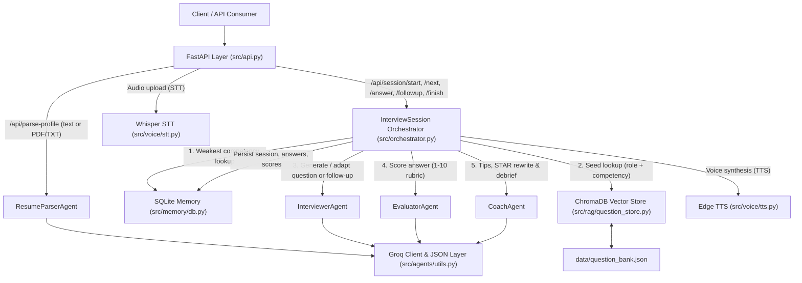
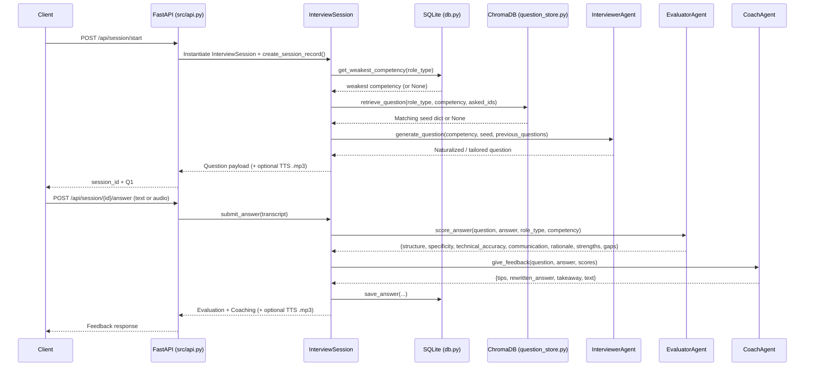

# Technical Architecture Report: AI Interview Coach (Backend, Agents & RAG)

**Scope:** This report documents the backend system architecture, multi-agent design, hybrid Retrieval-Augmented Generation (RAG) pipeline, deterministic orchestration loop, persistent memory layer, voice I/O subsystem, and REST API surface of **AI Interview Coach**. *(Frontend implementation details are intentionally excluded per scope.)*

---

## 1. Architectural Philosophy

The system is intentionally structured around a **deterministic Python orchestrator controlling narrow, single-responsibility LLM agents**, rather than an open-ended autonomous agent loop where an LLM decides tool calls and control flow.

Key design principles:
1. **Separation of Concerns Across Agents:** Parsing a resume, phrasing/generating a question, scoring an answer against a rubric, and coaching a candidate require competing incentives and temperatures. Splitting them into four isolated agents (`ResumeParserAgent`, `InterviewerAgent`, `EvaluatorAgent`, `CoachAgent`) prevents prompt bleed (e.g., an encouraging coach inflating rubric scores or an interviewer leaking grading criteria).
2. **Deterministic State Machine:** `InterviewSession` (`src/orchestrator.py`) owns session progression, competency rotation, RAG retrieval, SQLite persistence, and audio synthesis. The LLM never controls routing or termination.
3. **Hybrid Grounding (RAG + Contextual Generation):** Tagged seed questions in `data/question_bank.json` indexed in ChromaDB keep interviews anchored to structured competencies when an appropriate seed exists, while allowing dynamic contextual question generation and follow-up probing when roles, resumes, or job descriptions go beyond the static bank.
4. **Zero-Cost Local Retrieval & Persistence:** Embeddings run locally inside ChromaDB (`all-MiniLM-L6-v2` ONNX) and historical memory runs locally in SQLite (`memory.sqlite3`), leaving Groq API inference (LLM + Whisper) as the only external compute dependency.

---

## 2. End-to-End System Architecture



### Runtime Turn Sequence



---

## 3. Configuration & Resilient LLM Layer

### 3.1 Configuration (`src/config.py`)
Loaded via `python-dotenv`:
- `GROQ_API_KEY` (required; raises `EnvironmentError` on startup if missing)
- `MODEL`: `INTERVIEW_COACH_MODEL` (default: `openai/gpt-oss-120b`)
- `WHISPER_MODEL`: `WHISPER_MODEL` (default: `whisper-large-v3-turbo`)
- `TTS_VOICE`: `TTS_VOICE` (default: `en-US-GuyNeural`)
- Storage paths rooted at `BASE_DIR`:
  - `QUESTION_BANK_PATH`: `data/question_bank.json`
  - `CHROMA_DIR`: `chroma_db/`
  - `DB_PATH`: `memory.sqlite3`
  - `AUDIO_DIR`: `static/audio/` (created automatically)

### 3.2 Shared Inference & JSON Parsing (`src/agents/utils.py`)
All four agents invoke Groq through `chat_complete(...)`:
- **Singleton Client (`get_groq_client`):** Reuses a single `Groq(api_key=GROQ_API_KEY)` connection pool.
- **Model Fallback Chain:** Attempts the configured `MODEL` first, then falls back sequentially across `FALLBACK_MODELS = ("openai/gpt-oss-120b", "qwen/qwen3.8-27b", "openai/gpt-oss-20b")` if Groq raises `groq.NotFoundError` or returns empty content.
- **Reasoning Token Headroom:** Reasoning-capable models (such as `openai/gpt-oss-120b` and `qwen/qwen3.8-27b`) count internal reasoning tokens within `max_tokens`. Each agent allocates `1000–1400` tokens to prevent reasoning consumption from truncating the final output.
- **Structured JSON Enforcement (`extract_json`):** Structured agents request `response_format={"type": "json_object"}`. As defense-in-depth, `extract_json()` strips optional Markdown ```` ```json ... ``` ```` fences and falls back to locating the outermost `{ ... }` span before raising `ValueError`. No silent fake-score fallbacks are returned on parse failures.

---

## 4. Multi-Agent Design (`src/agents/`)

| Agent | File | Responsibility | Temp | Max Tokens | Output Format |
| :--- | :--- | :--- | :---: | :---: | :--- |
| `ResumeParserAgent` | `src/agents/resume_parser.py` | Extracts role, seniority, competencies, skills, and probe areas from resume/JD | `0.2` | `1200` | Strict JSON |
| `InterviewerAgent` | `src/agents/interviewer.py` | Crafts role/resume-aware questions and targeted follow-up probes | `0.65` / `0.5` | `1000` | Conversational text |
| `EvaluatorAgent` | `src/agents/evaluator.py` | Scores answers on 4 calibrated 1–10 dimensions + strengths/gaps | `0.1` | `1200` | Strict JSON |
| `CoachAgent` | `src/agents/coach.py` | Produces actionable tips, STAR rewrite, takeaway, and session debrief | `0.3` / `0.25` | `1400` | Strict JSON (+ flattened text) |

### 4.1 `ResumeParserAgent` (`src/agents/resume_parser.py`)
- **Inputs:** `resume_text` (populated from raw text and/or `pypdf.PdfReader` extraction in `src/api.py`) and `job_description`.
- **Behavior:** Infers an unrestricted, specific `role_type` (e.g., `"Senior Frontend Engineer"`, `"AI Engineer"`, `"Technical Program Manager"`), normalizes `seniority` to `{"entry", "mid", "senior", "staff"}` (default `"mid"`), normalizes `competencies` to up to 6 `snake_case` tokens (fallback `["problem_solving", "technical_depth", "communication", "ambiguity"]`), and extracts up to 10 `key_skills`, up to 5 `focus_areas` (concrete projects/gaps to probe), and a `summary`.

### 4.2 `InterviewerAgent` (`src/agents/interviewer.py`)
- **Initialization Context:** Stores `role_type`, `seniority`, truncated `resume_text` (2,000 chars), `job_description` (2,000 chars), and `focus_areas`.
- **`generate_question(competency, seed_question, previous_questions)`:**
  - Injects target role, seniority, competency, `focus_areas`, 900-char JD/resume excerpts, optional RAG `seed_question`, and the last 8 `previous_questions` to enforce non-repetition.
  - Instructed to ask **one** focused question in 1–3 conversational sentences without filler preamble.
  - Operates in two modes seamlessly: adapting a matching RAG seed question to the candidate's context, or synthesizing a fresh question when no bank match fits.
- **`generate_followup(question, answer, gaps)`:**
  - Takes the prior question, the candidate's verbatim answer, and the evaluator's detected `gaps` to ask a sharp 1–2 sentence follow-up probe while staying strictly in interviewer character (no coaching or praise).

### 4.3 `EvaluatorAgent` (`src/agents/evaluator.py`)
- **Inputs:** `question`, `answer`, `role_type`, `competency`.
- **Rubric:** Scores four orthogonal dimensions from `1` to `10` (clamped to `[1, 10]` integers via `_clamp_score`):
  1. `structure` (logical framing, STAR for behavioral, top-down framing for design)
  2. `specificity` (metrics, real artifacts, edge cases vs. vague claims)
  3. `technical_accuracy` (soundness of tradeoffs and domain depth)
  4. `communication` (clarity and directness)
- **Qualitative Signals:** Outputs `rationale` (1–2 sentences), `strengths` (up to 3 items), and `gaps` (up to 3 items — also fed directly into `InterviewerAgent.generate_followup()`).
- **Low Temperature (`0.1`):** Minimizes scoring variance across evaluations.

### 4.4 `CoachAgent` (`src/agents/coach.py`)
- **`give_feedback(question, answer, scores)`:**
  - Returns structured coaching: `tips` (2–3 concrete tips tied directly to what the candidate said/missed), `rewritten_answer` (a stronger 4–6 sentence version using STAR or structured framing), and `takeaway`.
  - Also synthesizes a flattened `text` string (`Tip 1: ... Stronger rewrite: ...`) for persistence and TTS audio synthesis.
- **`summarize_session(role_type, history_items)`:**
  - Condenses all Q&As and rubric scores from the completed session into an executive debrief: `overall_verdict`, `summary`, `top_strengths` (up to 4), `priority_improvements` (up to 4), and `next_drill_plan`.

---

## 5. RAG Architecture (`src/rag/question_store.py`)

### 5.1 Vector Store & Seed Corpus
- **Storage:** `chromadb.PersistentClient(path=CHROMA_DIR)` managing a single collection named `"questions"`.
- **Embeddings:** Uses ChromaDB's default local ONNX embedding model (`all-MiniLM-L6-v2`), requiring zero external embedding API keys or inference cost.
- **Seed Bank (`data/question_bank.json`):** Contains 20 tagged seed questions across four baseline roles (`TPM`: 7, `Software Engineer`: 5, `AI Engineer`: 5, `General`: 3), each carrying `id`, `text`, `role_type`, `competency`, and `difficulty`.
- **Indexing (`index_question_bank`):** Lazy-initialized on first query (`_collection.count() == 0`) using `_collection.upsert(...)` with `ids`, `documents` (`text`), and `metadatas` (`role_type`, `competency`, `difficulty`).
- **Dynamic Bank Growth (`add_question`):** Generates a `custom_<8-hex>` ID, appends the new entry to `data/question_bank.json`, and immediately upserts it into ChromaDB so it is searchable in the same runtime process.

### 5.2 Retrieval Strategy & Role-Relevance Guard
`retrieve_question(role_type, competency, exclude_ids)` intentionally avoids forcing unrelated seed questions onto custom roles:

1. Normalizes `role_type` and `competency` (`snake_case`).
2. Executes semantic query `"{competency} interview question for {role_type}"` (`n_results=min(10, count)`) across two metadata filter tiers:
   - **Tier 1:** Exact composite filter `{"$and": [{"role_type": role_type}, {"competency": normalized_comp}]}`
   - **Tier 2:** Competency filter `{"competency": normalized_comp}`
3. Iterates through candidates in similarity order, skipping any `qid` in `exclude_ids`.
4. **Role Compatibility Guard:** Accepts a candidate only if its metadata `role_type` is an exact case-insensitive match, `"general"`, or a substring match with the target `role_type`.
5. **Graceful Abstention:** If no unused, role-compatible seed exists, `retrieve_question` returns `None`. `InterviewSession` records `source = "dynamic_generated"` and delegates entirely to `InterviewerAgent.generate_question()` rather than retrieving an off-topic question from another discipline.

---

## 6. Deterministic Orchestration & Adaptive Loop (`src/orchestrator.py`)

`InterviewSession` acts as the state machine for a single interview run (`session_id = uuid.uuid4().hex`, `num_questions` clamped to `1..15`):

### 6.1 Competency Selection (`_pick_competency`)
1. Queries `memory.get_weakest_competency(self.role_type)` from SQLite to find the competency with the lowest historical mean score for that role.
2. Computes `unasked = [c for c in self.competencies if c not in self.asked_competencies]`.
3. If `unasked` is non-empty:
   - Picks `weakest` first if `weakest in unasked`;
   - Otherwise picks `unasked[0]`.
4. Once all session competencies have been covered once, cycles via `self.competencies[self.question_count % len(self.competencies)]`.

This ensures historical weaknesses are probed immediately at the start of a session while guaranteeing balanced coverage across all configured competencies.

### 6.2 State Transitions
- **`next_question()`:** Checks `question_count >= num_questions` (terminating with `{"done": True}`), selects competency, queries RAG, calls `InterviewerAgent.generate_question()`, records `asked_ids` / `asked_questions` / `asked_competencies`, increments `question_count`, and optionally synthesizes TTS audio (`question_audio`).
- **`ask_followup()`:** Reads the latest record from `self.qa_history`, calls `InterviewerAgent.generate_followup()` using the evaluator's detected `gaps`, and sets `current_question` with `is_followup = True` and `source = "dynamic_followup"` without incrementing `question_count` (so follow-ups do not consume the main question budget).
- **`submit_answer(answer_text)`:** Runs `EvaluatorAgent.score_answer()` -> `CoachAgent.give_feedback()` -> `memory.save_answer()` -> appends to `self.qa_history` -> optionally synthesizes `feedback_audio`.
- **`finish_session()`:** Marks `self.done = True`, invokes `CoachAgent.summarize_session()` if `qa_history` is non-empty, and updates the SQLite session record via `memory.complete_session_record()`.

---

## 7. Persistence & Analytics Layer (`src/memory/db.py`)

Backed by SQLite (`memory.sqlite3`) initialized on FastAPI startup via `memory.init_db()`:

- **`sessions` table:** `session_id` (PK), `role_type`, `seniority`, `competencies_json`, `num_questions`, `voice`, `created_at`, `completed_at`, `debrief_json`.
- **`answers` table:** `id` (PK autoincrement), `session_id`, `role_type`, `question_id`, `competency`, `question`, `answer`, `structure`, `specificity`, `technical_accuracy`, `communication`, `rationale`, `feedback`, `question_number`, `is_followup`, `created_at`.
- **Idempotent Schema Migration:** `init_db()` inspects `PRAGMA table_info(answers)` and executes `ALTER TABLE answers ADD COLUMN ...` for newer fields (`rationale`, `feedback`, `question_number`, `is_followup`) so existing databases upgrade cleanly without data loss.
- **Analytics Queries:**
  - `get_weakest_competency(role_type)`: Computes `AVG((structure + specificity + technical_accuracy + communication) / 4.0)` grouped by `competency` for matching `LOWER(role_type)` and returns the lowest-scoring competency.
  - `get_competency_stats(role_type=None)`: Aggregates attempt counts and per-dimension + overall averages ordered ascending by `avg_overall`.
  - `delete_history_item(answer_id)` and `clear_history()` manage persisted state.

---

## 8. Voice Pipeline & FastAPI Surface

### 8.1 Voice Subsystem (`src/voice/`)
- **Speech-to-Text (`stt.py`):** Sends uploaded audio bytes (persisted temporarily with original file extension and deleted inside a `finally:` block in `src/api.py`) to Groq's `whisper-large-v3-turbo` transcription endpoint.
- **Text-to-Speech (`tts.py`):** Uses `edge_tts.Communicate(text, TTS_VOICE)` to write UUID-named `.mp3` files into `static/audio/`. Because `edge_tts` is async and FastAPI/Uvicorn already owns the main thread's event loop, `synthesize_to_file()` dispatches `asyncio.run(...)` onto a dedicated `ThreadPoolExecutor(max_workers=2)` to prevent event-loop collision.

### 8.2 FastAPI Endpoints (`src/api.py`)
- `GET /api/health` — Returns active LLM, Whisper, and TTS configuration.
- `POST /api/parse-profile` — Accepts form text and/or uploaded resume file (`.pdf` extracted via `pypdf.PdfReader`, or UTF-8 text/markdown); validates non-empty input (`400`) and invokes `ResumeParserAgent`.
- `POST /api/session/start` — Creates an `InterviewSession` in `SESSIONS` and returns question 1.
- `GET /api/session/{session_id}` — Returns serialized session state (`to_dict()`), or `404` if missing.
- `POST /api/session/{session_id}/answer` — Accepts `answer_text` or `audio` upload (transcribed via Whisper), evaluates, coaches, and persists to SQLite.
- `POST /api/session/{session_id}/next` — Generates the next question or finalizes the session debrief when complete.
- `POST /api/session/{session_id}/followup` — Generates a dynamic follow-up probe on the last answer (`400` if no answer exists yet).
- `POST /api/session/{session_id}/finish` — Finalizes session and generates debrief.
- `GET /api/history`, `DELETE /api/history/{answer_id}`, `DELETE /api/history` — Read and manage SQLite analytics/history.
- `GET /api/question-bank`, `POST /api/question-bank` — Inspect and dynamically append/index RAG seed questions.
- `GET /api/audio/{filename}` — Serves synthesized `.mp3` audio with `Path(filename).name` path-traversal sanitization.

Upstream Groq/transcription failures surface cleanly as HTTP `502` with error details rather than returning fabricated fallback data.

---

## 9. Architectural Tradeoffs & Recommended Next Steps

1. **In-Memory Session Store:** Active `InterviewSession` objects live in the in-process `SESSIONS` dictionary. Although completed answers and debriefs persist in SQLite, a server restart drops in-progress session objects. Rehydrating `InterviewSession` state from `sessions` + `answers` in SQLite would make active sessions restart-resilient.
2. **Ephemeral Audio Cleanup:** While STT temp files are deleted immediately in `finally:`, synthesized TTS `.mp3` files in `static/audio/` are retained indefinitely. Adding a TTL cleanup task on startup or after playback would bound disk usage.
3. **Adaptive Targeting Heuristic:** `_pick_competency()` currently relies on unweighted historical mean scores across all past attempts for a role. Extending this with recency weighting (exponential decay) and difficulty progression (`entry` -> `mid` -> `senior`) would make long-term adaptation more responsive.
4. **Concurrency Scaling:** Moving `SESSIONS` out of process memory and swapping SQLite for PostgreSQL + a shared vector store would be required if the system ever transitions from a single-user local tool to a multi-worker deployment.

