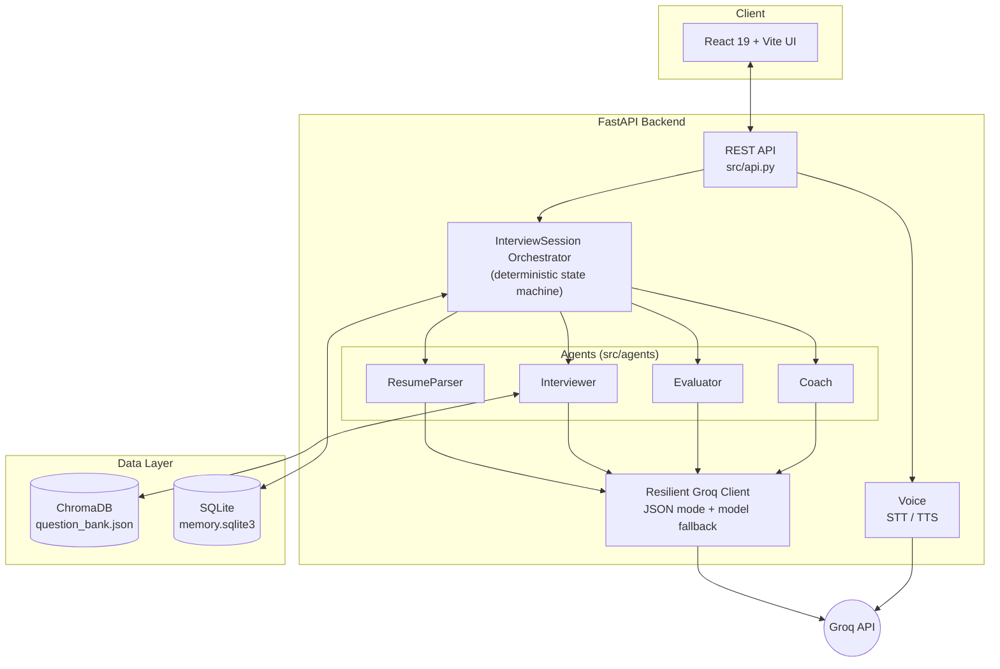
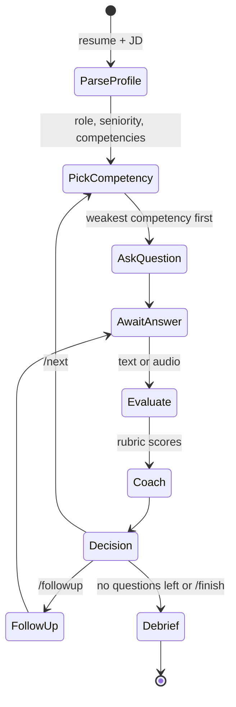
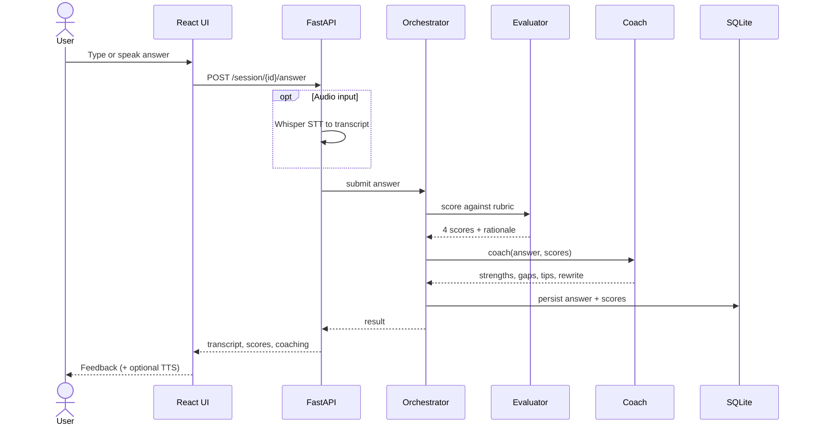
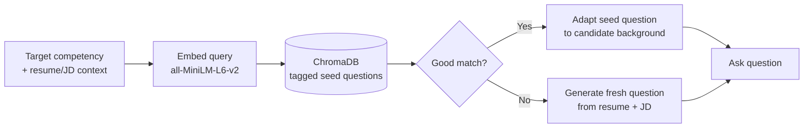
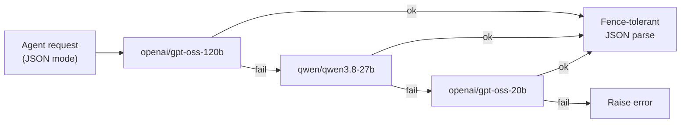
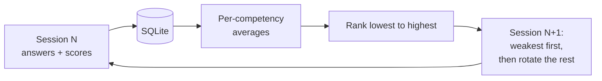
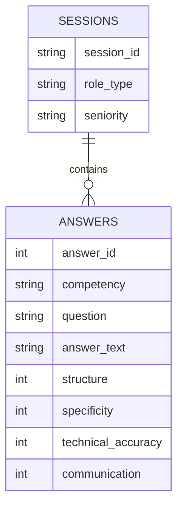

# AI Interviewer Agent

Upload a resume and job description to get a tailored mock interview, rubric-scored answers, live coaching, and cross-session memory that targets your weakest competencies first.

---

## Features

| Feature | Description |
|---|---|
| Profile Analysis | Parses `.pdf` / `.txt` / `.md` resume and pasted JD. Infers role, seniority (`entry` / `mid` / `senior` / `staff`), competencies, key skills, focus areas |
| Hybrid RAG Questions | Retrieves seed questions from ChromaDB (local `all-MiniLM-L6-v2`, $0 embedding cost) or generates fresh ones from resume + JD |
| Live Follow-Ups | Probes gaps or claims in your last answer |
| Rubric Scoring | 1-10 on `structure`, `specificity`, `technical_accuracy`, `communication`, plus strengths, gaps, two tips, and a rewritten answer |
| Adaptive Memory | SQLite tracks per-competency averages; the weakest competency is drilled first in the next session |
| Debrief | Overall verdict, strengths, priority improvements, next drill plan |
| Voice Mode | Speak answers (Groq Whisper), hear questions and coaching (`edge-tts`) |

---

## High-Level Design (HLD)

### System Architecture



### Interview Lifecycle



---

## Low-Level Design (LLD)

### Answer Turn (Sequence)



### Hybrid Question Generation



### LLM Client Fallback



### Adaptive Memory



### Data Model



### Module Layout

```
.
├── main.py                    # Entry point
├── src/
│   ├── api.py                 # FastAPI routes + static serving
│   ├── orchestrator.py        # InterviewSession state machine
│   ├── agents/                # Parser, Interviewer, Evaluator, Coach
│   │   └── utils.py           # Resilient Groq client
│   ├── rag/question_store.py  # ChromaDB store
│   ├── memory/db.py           # SQLite + analytics
│   └── voice/                 # stt.py, tts.py
├── data/question_bank.json    # Seed questions
├── frontend/                  # React + Vite (build -> frontend/dist)
└── static/audio/              # Generated TTS files
```

---

## Tech Stack

| Layer | Technology |
|---|---|
| LLM | Groq: `openai/gpt-oss-120b`, fallback `qwen/qwen3.8-27b`, `openai/gpt-oss-20b` |
| Retrieval | ChromaDB + local `all-MiniLM-L6-v2` embeddings |
| Memory | SQLite (`memory.sqlite3`) |
| Voice | Groq `whisper-large-v3-turbo` (STT), `edge-tts` `en-US-GuyNeural` (TTS) |
| Backend | FastAPI, Uvicorn, `pypdf` |
| Frontend | React 19, Vite, `lucide-react` |

---

## Setup

**1. Backend**

```bash
python -m venv venv
source venv/bin/activate        # Windows: .\venv\Scripts\activate
pip install -r requirements.txt
cp .env.example .env            # Windows: copy .env.example .env
# Add your key from https://console.groq.com/keys to .env
```

**2. Frontend**

```bash
cd frontend && npm install && npm run build && cd ..
```

**3. Run**

```bash
python main.py
```

Open http://127.0.0.1:8000.

For hot reload, run `npm run dev` in `frontend/` (Vite on `:5173`, proxies `/api/*` to `:8000`).

---

## API Reference

| Method | Endpoint | Purpose |
|:--|:--|:--|
| `GET` | `/api/health` | Server status + configured models |
| `POST` | `/api/parse-profile` | Parse resume (`.pdf`/`.txt`/`.md`) + JD into role and competencies |
| `POST` | `/api/session/start` | Create session, return first question |
| `GET` | `/api/session/{id}` | Fetch active session state |
| `POST` | `/api/session/{id}/answer` | Submit text/audio; returns transcript, scores, coaching |
| `POST` | `/api/session/{id}/next` | Next adaptive question, or debrief if done |
| `POST` | `/api/session/{id}/followup` | Targeted follow-up probe |
| `POST` | `/api/session/{id}/finish` | End early and generate debrief |
| `GET` | `/api/history` | Persisted answers + competency stats |
| `DELETE` | `/api/history/{answer_id}` , `/api/history` | Delete one / clear all |
| `GET` `POST` | `/api/question-bank` | List or add and index a seed question |

---

## Known Limitations

| Limitation | Impact |
|---|---|
| Active sessions held in in-memory `SESSIONS` dict | Server restart clears in-progress sessions (completed answers persist) |
| TTS `.mp3` files in `static/audio/` are not pruned | Disk usage grows over time |
| Lowest-historical-average targeting heuristic | No adaptive-difficulty / IRT model |
| Single-user, local, no auth | No multi-tenant isolation |

For a deeper breakdown, see [ARCHITECTURE_REPORT.md](ARCHITECTURE_REPORT.md).
